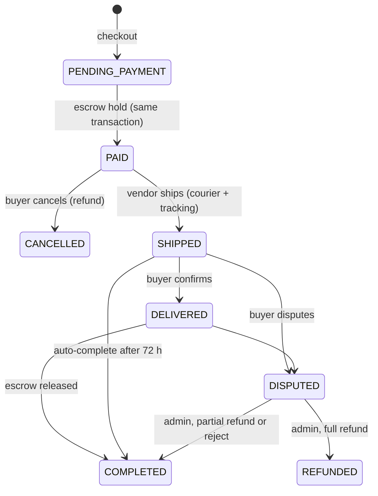

# KoboMarket

KoboMarket is the backend for an online marketplace with many vendors, like Jumia. A buyer pays from a wallet, and KoboMarket holds the money (escrow) until the goods arrive. The vendor is paid when the buyer confirms delivery, or 72 hours after shipping if the buyer says nothing. Every naira that moves is written down in a ledger in PostgreSQL.

**Built with:** Node.js 22 · Express · MongoDB (catalogue, users) · PostgreSQL (money) · Redis + BullMQ (background jobs)

## Quick start

```bash
cp .env.example .env
docker compose up -d
docker compose exec api npm run seed
```

`npm run seed` adds demo data. You can run it again safely: nothing is created or credited twice.

| Role   | Email                                                                  | Notes                                                  |
| ------ | ---------------------------------------------------------------------- | ------------------------------------------------------ |
| Admin  | `admin@kobomarket.test`                                                |                                                        |
| Vendor | `ada@kobomarket.test`, `tunde@kobomarket.test`, `musa@kobomarket.test` | Approved stores with 20 products between them          |
| Buyer  | `chioma@`, `emeka@`, `fatima@`, `kunle@`, `ngozi@kobomarket.test`      | Wallets funded through the ledger (₦50,000–₦1,000,000) |

Every demo account uses the password `KoboMarket#2026`. The seed is for demos only and refuses to run when `NODE_ENV=production`.

- API: http://localhost:3000
- Health: http://localhost:3000/health
- API docs (Swagger UI): http://localhost:3000/api-docs · raw OpenAPI JSON: http://localhost:3000/api-docs.json
- Postman: import [`docs/postman/KoboMarket.postman_collection.json`](docs/postman/KoboMarket.postman_collection.json). The **Demo flow** folder walks through the whole story on the seed data (fund → checkout → ship → confirm → payout → dispute → reports) and saves the ids as it goes. `npm run postman:demo` runs the same flow from the command line. The **All endpoints** folder has every request.

### Running without Docker

You need **Node.js 22**.

```bash
cp .env.example .env   # then switch to Option B in the Databases section
npm install
npm run migrate
npm run seed           # demo data (optional)
npm run dev            # API
npm run dev:worker     # background jobs, in a second terminal
```

## Project structure

```text
src/
  app.js, server.js, worker.js   express app, HTTP entry, background worker entry
  config/                        checks the env settings and stops early if one is wrong
  db/                            postgres (knex), mongo (mongoose), redis
  shared/                        errors, middleware, money helpers, logger, events
  integrations/payments/         Paystack and a mock provider behind one interface
  modules/<feature>/             routes → controller → service → repository
  jobs/                          outbox relay, auto-complete, payouts, reconciler
migrations/   seeds/ (demo data)   scripts/ (seed, audit, make-admin)   tests/   docs/
```

## Why two databases

I use two databases because KoboMarket keeps two very different kinds of data.

**MongoDB is the shop window.** It holds users, vendor stores, products (with their variants and stock), carts, reviews and notifications. This data changes shape often: one product has sizes and colours, another has none, and a store can gain new fields. MongoDB lets each record carry what it needs without changing a table every time, and its text search and filters suit a product catalogue.

**PostgreSQL is the bank vault.** It holds wallets, the ledger, orders and sub-orders, disputes, payouts and settings. Money needs strict rules, and PostgreSQL enforces them itself, even if my code has a bug:

- **Transactions:** a checkout either happens fully or not at all.
- **Row locks** (`SELECT ... FOR UPDATE`): two payments cannot spend the same naira.
- **Checks and triggers:** amounts are whole kobo in `BIGINT`, every transaction must add up to zero, and ledger rows can never be edited or deleted.

**The rule between them: money lives only in PostgreSQL.** MongoDB never holds a balance. A product price in MongoDB is only the listed price; what the buyer really paid is copied into PostgreSQL at checkout (`order_items.unit_price_kobo`). The two sides are linked by ids: a PostgreSQL account stores the MongoDB user's `_id` as `owner_id`.

**The cost:** one checkout touches both databases, so they could disagree if one save works and the other fails. I handle it this way:

1. Reserve the stock in MongoDB first, then take the money in PostgreSQL.
2. If the PostgreSQL step fails, put the stock back.
3. If putting it back also fails, save a `compensations` record that a background job retries.
4. Every follow-up event is saved in an `outbox_events` table in the same PostgreSQL transaction, so no event is lost even if Redis is down.

## Architecture


- **The API never talks to Redis.** When something changes (for example, an order is paid), the change and a note about it (an event) are saved together in PostgreSQL, in the `outbox_events` table. A separate worker process reads those events, passes them to BullMQ and runs the timed jobs. If Redis goes down, the API keeps working and the events wait.
- **Layers:** routes check who you are and validate the input → controllers only deal with HTTP → services hold all the business rules and own the database transactions → repositories are the only code that touches SQL or Mongoose.
- **Only `src/modules/ledger` may write ledger rows or balances.** Every money movement is one call to `LedgerService.post()`, and its entries must add up to zero.

### Order lifecycle

One checkout creates one order, with one sub-order for each vendor. Each sub-order follows the steps below (code in `src/modules/orders/state-machine.js`). Any other move is refused with `409 INVALID_TRANSITION`.



## Money and the ledger

All money is stored as whole **kobo** (₦1 = 100 kobo) in `BIGINT` columns, never as decimals. Amounts in requests must be whole numbers, and ESLint blocks `parseFloat` and `toFixed` in the money code. Commission is stored in basis points (500 = 5%). It is rounded down and the vendor gets the rest. The rate is copied onto each sub-order at checkout, so a later change does not affect old orders.

Every money movement is written twice: once as money leaving an account (debit) and once as money entering another (credit).

| Event                                                 | Ledger transaction | Debit (−)                  | Credit (+)                                                                     |
| ----------------------------------------------------- | ------------------ | -------------------------- | ------------------------------------------------------------------------------ |
| Wallet funded (verified webhook)                      | `FUNDING`          | `EXTERNAL_PAYSTACK`        | buyer wallet                                                                   |
| Checkout                                              | `ESCROW_HOLD`      | buyer wallet               | `PLATFORM_ESCROW`                                                              |
| Cancel before shipping                                | `REFUND`           | `PLATFORM_ESCROW`          | buyer wallet                                                                   |
| Delivery confirmed / auto-complete / dispute rejected | `ESCROW_RELEASE`   | `PLATFORM_ESCROW`          | vendor wallet (net) + `PLATFORM_REVENUE` (commission)                          |
| Dispute: full refund                                  | `REFUND`           | `PLATFORM_ESCROW`          | buyer wallet                                                                   |
| Dispute: partial refund                               | `REFUND`           | `PLATFORM_ESCROW`          | buyer (refund) + vendor (rest − commission) + revenue (commission on the rest) |
| Payout requested                                      | `PAYOUT_HOLD`      | vendor wallet              | `PLATFORM_PAYOUT_CLEARING`                                                     |
| Payout succeeded                                      | `PAYOUT_SETTLE`    | `PLATFORM_PAYOUT_CLEARING` | `EXTERNAL_PAYSTACK`                                                            |
| Payout failed                                         | `PAYOUT_REVERSAL`  | `PLATFORM_PAYOUT_CLEARING` | vendor wallet                                                                  |

**The database itself refuses bad data, even if my code has a bug:**

- Amounts must be more than zero (`CHECK (amount_kobo > 0)`), and a user wallet cannot go below zero (`CHECK (balance_kobo >= 0)`).
- A trigger rejects any transaction whose entries do not add up to zero.
- Triggers refuse `UPDATE`, `DELETE` and `TRUNCATE` on `ledger_entries` and `transactions`. A mistake is fixed by adding a new entry that reverses it.
- Each transaction has a unique `reference` (`ORD-<id>`, `SUB-<id>-RELEASE`, `DSP-<id>`, `PAY-<id>-HOLD`, or the Paystack reference for funding), so the same money event cannot happen twice.

**`npm run audit:ledger`** checks the books and prints PASS or FAIL. It checks that:

- the whole ledger adds up to zero;
- every stored balance equals the sum of its entries;
- every transaction balances;
- no account is negative except `EXTERNAL_PAYSTACK`.

`EXTERNAL_PAYSTACK` stands for the outside world. Money comes from it when a wallet is funded and goes back to it on a payout, so its balance is always −(total funded − total paid out). That makes "the ledger adds up to zero" the same as the brief's rule: all user wallets + escrow + revenue + payout clearing = total funded − total paid out.

## Data model

### PostgreSQL (generated from the live schema by `npm run docs:generate`)

<!-- erd:start -->


<!-- erd:end -->

### MongoDB collections (generated from the Mongoose models by `npm run docs:generate`)

No collection is the real record of money. A product's `priceKobo` is only the listed price (what the buyer paid is copied into `order_items`), and a user's `walletStatus` only says whether their PostgreSQL wallet exists yet.

<!-- collections:start -->

| Collection           | Fields                                                                                                             | Indexes                                                                                                                                                                                |
| -------------------- | ------------------------------------------------------------------------------------------------------------------ | -------------------------------------------------------------------------------------------------------------------------------------------------------------------------------------- |
| `carts`              | userId, items                                                                                                      | `{ userId }` (unique)                                                                                                                                                                  |
| `compensations`      | type, payload, reason, status, attempts, lastError, claimedUntil                                                   | `{ status, updatedAt }`                                                                                                                                                                |
| `loginAttempts`      | key, count, windowStart                                                                                            | `{ key }` (unique)<br>`{ windowStart }` (TTL)                                                                                                                                          |
| `notifications`      | userId, type, title, body, data, readAt, sourceEventId                                                             | `{ userId, sourceEventId, type }` (unique)<br>`{ userId, readAt, _id -1 }`<br>`{ userId, _id -1 }`                                                                                     |
| `products`           | vendorId, name, slug, description, category, priceKobo, stock, variants, tags, images, rating, isActive, deletedAt | `{ slug }` (unique)<br>`{ name text, description text, tags text }`<br>`{ category, priceKobo, _id }`<br>`{ vendorId, _id -1 }`<br>`{ priceKobo, _id }`<br>`{ rating.avg -1, _id -1 }` |
| `reviews`            | productId, buyerId, subOrderId, rating, comment                                                                    | `{ productId, buyerId }` (unique)<br>`{ productId, _id -1 }`                                                                                                                           |
| `sessions`           | userId, familyId, tokenHash, replacedBy, revokedAt, expiresAt, ip, userAgent                                       | `{ userId }`<br>`{ familyId }`<br>`{ tokenHash }` (unique)<br>`{ expiresAt }` (TTL)                                                                                                    |
| `users`              | email, passwordHash, name, roles, emailVerifiedAt, status, frozenAt, frozenBy, frozenReason, walletStatus          | `{ email }` (unique)<br>`{ walletStatus }`                                                                                                                                             |
| `vendors`            | userId, storeName, slug, description, bank, status, rejectionReason, reviewedBy, reviewedAt                        | `{ userId }` (unique)<br>`{ slug }` (unique)<br>`{ status, _id }`                                                                                                                      |
| `verificationTokens` | userId, type, tokenHash, expiresAt, usedAt                                                                         | `{ userId }`<br>`{ tokenHash }` (unique)<br>`{ expiresAt }` (TTL)                                                                                                                      |

<!-- collections:end -->

## Consistency, concurrency and idempotency

### Keeping MongoDB and PostgreSQL in step

The two databases cannot share one transaction. So where one request touches both, KoboMarket undoes the first step if the second one fails. For work that happens afterwards, it uses the outbox table.

| Problem                                                                 | What happens                                                                                                                                                                                                                                                                                             | Proved by                                                                                                                     |
| ----------------------------------------------------------------------- | -------------------------------------------------------------------------------------------------------------------------------------------------------------------------------------------------------------------------------------------------------------------------------------------------------- | ----------------------------------------------------------------------------------------------------------------------------- |
| A user is saved in MongoDB, but creating the wallet in PostgreSQL fails | Sign-up still succeeds, with `walletStatus: PENDING`. Money endpoints answer `409 WALLET_NOT_READY` until a background job opens the wallet and sets `READY`. Running the job twice does no harm                                                                                                         | [`auth.register.test.js`](tests/integration/auth.register.test.js), [`maintenance.test.js`](tests/jobs/maintenance.test.js)   |
| Checkout changes stock (MongoDB) and money (PostgreSQL)                 | Stock is **reserved first** (one conditional `$inc` per line, all or nothing). Then one PostgreSQL transaction takes the money and creates the order. If that fails, the stock is put back. If putting it back fails, a `compensations` document is saved and a job retries it                           | [`checkout.test.js`](tests/integration/checkout.test.js), [`stock.test.js`](tests/integration/stock.test.js)                  |
| Follow-up work (notifications) must not get lost or slow the request    | The event is saved as an `outbox_events` row in the same transaction as the change. The worker picks rows up with `FOR UPDATE SKIP LOCKED` and a short lease, waits longer after each failure, and marks a row `DEAD` after 10 tries. An event can arrive more than once, so handlers are safe to repeat | [`outbox-relay.test.js`](tests/jobs/outbox-relay.test.js), [`notifications.test.js`](tests/integration/notifications.test.js) |

I reserve stock first instead of following the brief's order (money first, then stock, with a refund if stock fails). This way a sold-out item never touches a wallet, and putting stock back is simpler and safer than refunding a payment.

### Concurrency

What happens when two things run at the same moment.

| What could go wrong                                  | What stops it                                                                                                                                                                                                                                                                                          | Proved by                                                                        |
| ---------------------------------------------------- | ------------------------------------------------------------------------------------------------------------------------------------------------------------------------------------------------------------------------------------------------------------------------------------------------------ | -------------------------------------------------------------------------------- |
| 10 checkouts at once, wallet can pay for 3           | The wallet row is locked with `SELECT ... FOR UPDATE` inside `LedgerService.post()`, and accounts are always locked in ascending id order. The escrow hold is posted **first** in the checkout transaction, so the wallet lock is taken before any foreign-key lock (an early version deadlocked here) | [`checkout.concurrency.test.js`](tests/concurrency/checkout.concurrency.test.js) |
| 2 buyers, last item                                  | Conditional `$inc` (`stock >= qty`) in MongoDB, so only one can win                                                                                                                                                                                                                                    | [`checkout.test.js`](tests/integration/checkout.test.js)                         |
| 2 payout requests in the same millisecond            | Wallet row lock plus a partial unique index: one `PENDING` payout per vendor                                                                                                                                                                                                                           | [`payouts.concurrency.test.js`](tests/concurrency/payouts.concurrency.test.js)   |
| Two transfers in opposite directions                 | Locks are always taken in ascending account id, so they cannot deadlock                                                                                                                                                                                                                                | [`ledger.concurrency.test.js`](tests/concurrency/ledger.concurrency.test.js)     |
| Buyer confirms while auto-complete runs; two workers | `FOR UPDATE SKIP LOCKED`, and the status is checked again after the lock                                                                                                                                                                                                                               | [`auto-complete.test.js`](tests/jobs/auto-complete.test.js)                      |
| The same webhook sent twice, or five times at once   | Unique `webhook_events` id, a lock on the funding row, and a unique ledger reference                                                                                                                                                                                                                   | [`wallet.webhook.test.js`](tests/integration/wallet.webhook.test.js)             |
| Reviews posted at the same time                      | The rating is changed in one atomic MongoDB update                                                                                                                                                                                                                                                     | [`reviews.test.js`](tests/integration/reviews.test.js)                           |

### Idempotency

`POST /wallet/fund`, `POST /orders/checkout` and `POST /payouts` need an `Idempotency-Key` header, so a retry or a double click does not repeat the action.

- Same key and same body: the saved response is returned again.
- Same key but a different body: `409 IDEMPOTENCY_KEY_REUSED`.
- The first request is still running: `409 REQUEST_IN_PROGRESS`.
- Server error: the key is freed so the client can try again.

A key is claimed per user and endpoint with one `INSERT ... ON CONFLICT`, and keys expire after 24 hours. Proved by [`idempotency.test.js`](tests/integration/idempotency.test.js) and the endpoint tests.

## Tests

```bash
npm test               # everything (integration tests need the databases in .env / .env.local)
npm run test:unit      # no database needed
npm run audit:ledger   # PASS / FAIL money check; CI runs it after the whole suite
```

CI (GitHub Actions) runs lint and the unit tests. It then starts everything with `docker compose up` and runs every integration, concurrency and job test inside it. It also proves the worker passes an event through Redis, runs `npm run seed` twice, and ends with `npm run audit:ledger`.

| Required test (brief §8)                                  | File                                                                                                                            |
| --------------------------------------------------------- | ------------------------------------------------------------------------------------------------------------------------------- |
| 1. Login fails before email verification                  | [`auth.login.test.js`](tests/integration/auth.login.test.js)                                                                    |
| 2. Reused refresh token is rejected and ends all sessions | [`auth.sessions.test.js`](tests/integration/auth.sessions.test.js)                                                              |
| 3. A buyer cannot reach vendor or admin routes            | [`rbac.test.js`](tests/integration/rbac.test.js)                                                                                |
| 4. The same webhook twice credits once                    | [`wallet.webhook.test.js`](tests/integration/wallet.webhook.test.js)                                                            |
| 5. A badly signed webhook is rejected                     | [`wallet.webhook.test.js`](tests/integration/wallet.webhook.test.js)                                                            |
| 6. Insufficient balance: no order, no ledger entries      | [`checkout.test.js`](tests/integration/checkout.test.js)                                                                        |
| 7. 10 concurrent checkouts, wallet affords 3 → exactly 3  | [`checkout.concurrency.test.js`](tests/concurrency/checkout.concurrency.test.js)                                                |
| 8. 2 buyers, last item → exactly 1                        | [`checkout.test.js`](tests/integration/checkout.test.js)                                                                        |
| 9. Same Idempotency-Key on checkout → one order           | [`checkout.test.js`](tests/integration/checkout.test.js)                                                                        |
| 10. Invalid transition (PAID → COMPLETED) rejected        | [`state-machine.test.js`](tests/unit/state-machine.test.js), [`orders.fulfil.test.js`](tests/integration/orders.fulfil.test.js) |
| 11. Completion splits vendor and revenue correctly        | [`orders.fulfil.test.js`](tests/integration/orders.fulfil.test.js)                                                              |
| 12. Auto-complete skips a disputed sub-order              | [`auto-complete.test.js`](tests/jobs/auto-complete.test.js), [`disputes.test.js`](tests/integration/disputes.test.js)           |
| 13. Partial refund leaves the ledger balanced             | [`disputes.test.js`](tests/integration/disputes.test.js)                                                                        |
| 14. Failed payout returns the money                       | [`payout-processor.test.js`](tests/jobs/payout-processor.test.js)                                                               |
| 15. `audit:ledger` passes after the suite                 | CI `docker-smoke` job                                                                                                           |

Ledger rows cannot be deleted, so tests never clear tables. Each test creates its own users, wallets and products and checks only those.

## Assumptions and design decisions

Things the brief leaves open, and what I decided.

### Buying and stock

- **Vendors cannot buy their own products.** The brief lets one account be both buyer and vendor but says nothing about buying from yourself. I block it at add-to-cart and again at checkout, so a vendor cannot fake sales to climb the "top vendors" report.
- **Checkout reserves stock first, then takes the money.** The brief's order is money first, then stock, with a refund if stock fails. Reserving first means a sold-out item never touches the wallet. If the PostgreSQL step fails, the stock is put back; if that also fails, a `compensations` document is saved for a job to retry.
- **Inside the checkout transaction, the escrow hold comes before the order rows.** That locks the wallet row first. When the order was inserted first, parallel checkouts deadlocked (found by the 10-checkouts-at-once test).
- **A changed price stops checkout.** The cart is updated to the current price and the buyer checks out again, so nobody pays a price they have not seen.
- **A vendor sets stock as a fixed number** (`PATCH /products/:id`). If a checkout lowers the stock between the vendor reading it and saving, the vendor's number wins. See known limitations.
- **Search results are not ranked by relevance.** Search narrows the results and the chosen sort orders them, because a relevance score cannot be used as a paging cursor.

### Orders

- **Cancelling is all or nothing.** An order can be cancelled only while every sub-order is still `PAID`. If any vendor has shipped, the cancel is refused.
- **The commission rate is copied onto each sub-order at checkout**, so an admin changing the rate later does not change what was agreed.
- **Order status is worked out, not stored.** It comes from the sub-orders (their shared status, or `IN_PROGRESS`), so the two can never disagree.
- **Shipping needs a courier name and a tracking number.**
- **Vendors list their own sub-orders** at `GET /vendors/me/sub-orders`. It is not in the brief's endpoint list, but vendors must be able to "view orders".
- **Refunds do not put stock back.** The goods have already shipped, and handling returns is outside this project.

### Disputes

- **A dispute is opened before confirming delivery.** Confirming means "I am satisfied": it moves the sub-order through `DELIVERED` to `COMPLETED` and releases the money in one step. So the brief's `DELIVERED → DISPUTED` move exists in the state machine but is never reached. A buyer with a problem disputes while the sub-order is `SHIPPED`, which also stops auto-complete.
- **`REFUNDED` is an extra sub-order state** for a fully refunded dispute, so it does not look like a completed sale. A partial refund or a rejected dispute ends as `COMPLETED`.
- **A partial refund is one balanced ledger posting:** escrow → buyer (the refund), vendor (the rest minus commission) and revenue (commission on the rest only).
- **A vendor can reply to a dispute once, with their own evidence**, and the admin sees both sides. `GET /disputes/mine` lists a user's disputes as buyer or vendor.

### Payouts

- **Hold first, transfer later.** A payout request moves the money from the vendor wallet to `PLATFORM_PAYOUT_CLEARING` at once. A worker then sends the bank transfer outside any database transaction, and either settles it (clearing → `EXTERNAL_PAYSTACK`) or reverses it (clearing → vendor). Two requests in the same millisecond wait on the wallet lock; the second one fails and rolls back. The payout id is the transfer reference, so a retried transfer cannot pay twice.
- **A provider error never reverses a payout.** I cannot know whether the money left, so the payout stays `PENDING` and is retried (an error is logged after 10 tries for an admin to see). Only a clear "failed" from the provider returns the money. While a payout is `PENDING`, the vendor cannot request another (the brief's rule).
- **Bank details are copied onto each payout** when it is requested, so changing the bank account later cannot redirect a payout that is already on its way.

### Accounts and admin

- **Frozen users can still fund their wallet.** The brief blocks orders and withdrawals for frozen accounts; money coming in does no harm.
- **Freezing a user acts in both databases.** The user is marked `FROZEN` in MongoDB (checkout and payouts refuse them) and their wallet is marked `FROZEN` in PostgreSQL, so `LedgerService.post()` itself refuses to take money from it. Refunds can still be paid in. Freezing and unfreezing are safe to repeat, and an admin cannot freeze themselves.
- **A rejected vendor may apply again**, which puts the same application back to `PENDING`. Only approved stores are shown publicly.
- **Reviews need a completed order.** This is checked in PostgreSQL, where orders live. One review per buyer per product (unique index). The product's rating is changed in one atomic MongoDB update, so reviews posted at the same time never lose a vote.
- **Reports are worked out in SQL**, not in JavaScript loops, and count days and months in Lagos time (`Africa/Lagos`). Revenue per day lists every day in the range, with zero for days without sales. Top vendors counts sub-orders completed this month, minus partial refunds. The escrow report shows the `PLATFORM_ESCROW` balance next to the unfinished sub-orders that should explain it.
- **`GET /admin/transactions`** lists every ledger transaction with its entries. It is not in the brief's endpoint list, but it delivers "view all transactions" for the admin role.
- **A commission change applies to new checkouts only**, and is capped at 50% so a typing mistake cannot hand the platform the whole sale.

### Background work

- **The API never talks to Redis.** Every business change saves an `outbox_events` row in the same PostgreSQL transaction, and the worker passes those rows to a BullMQ queue. If Redis is down, checkouts still work and the events wait. The worker claims rows with `FOR UPDATE SKIP LOCKED` and a short lease, publishes after the transaction ends (no network call while holding row locks), waits longer after each failure, and marks a row `DEAD` after 10 failures. An event can arrive more than once, so handlers are safe to repeat.
- **Timed jobs are safe to run on several workers at once.** Auto-complete locks each sub-order again with `status = 'SHIPPED'` and `SKIP LOCKED`, so a disputed or just-confirmed sub-order is skipped and escrow is released only once. Compensation retries are claimed with a lease.

## Known limitations and improvements

- **Every escrow movement locks the single `PLATFORM_ESCROW` row**, so checkouts, releases and refunds across the whole platform wait behind each other. This is correct and fine at this size. A busy marketplace would split escrow into several accounts to spread the load.
- **Tests share one database.** On my machine, integration tests run against the Neon `production` branch (CI uses a fresh PostgreSQL in Docker). Tests never clear tables and check only their own data, but a separate Neon `test` branch would be cleaner.
- **The app connects as the table owner**, so the triggers are the real guard on ledger rows. A restricted database role without `UPDATE` and `DELETE` on the ledger tables would add a second guard.
- **Vendors set stock as a fixed number** (`PATCH /products/:id`). A checkout that reserves stock between the vendor reading and saving would be overwritten. An endpoint that adds or subtracts stock with `$inc` would fix this.
- **Search results are not ranked by relevance**, because a relevance score cannot be a paging cursor.
- **Failed jobs show only in the logs and the database.** `DEAD` outbox events, `DEAD` compensations, and payouts stuck `PENDING` because the provider cannot be reached are logged as errors, but there is no admin screen to retry them.
- **Two pairs of writes are not one transaction:** a review and the product's rating update, and a compensation that ran but was not yet marked done. Both can only go wrong in a rare crash, and `rating.sum` and `rating.count` allow the rating to be recalculated exactly from the reviews.
- **The mock payment provider keeps its state in memory**, so a funding started before an API restart cannot be paid on the mock checkout afterwards (start a new one). Real Paystack has no such limit.
- **Reports use Lagos time** (`Africa/Lagos`) and naira only. There is no support for other currencies.
- **Notifications are fetched on request** (`GET /notifications`). Live delivery with Socket.io is a listed bonus that I did not build.
- **Future improvements** (outside this project): a delivery code the buyer reads to the rider, returns and restocking after refunds, identity checks on vendor bank details, part shipments, and real email delivery (emails are logged to the console for now).
