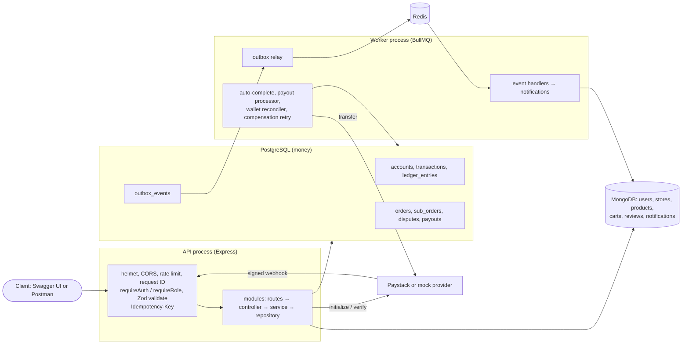
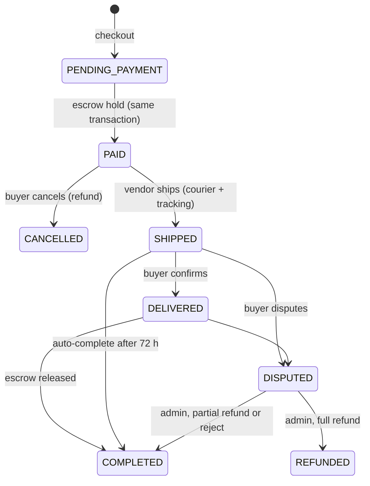
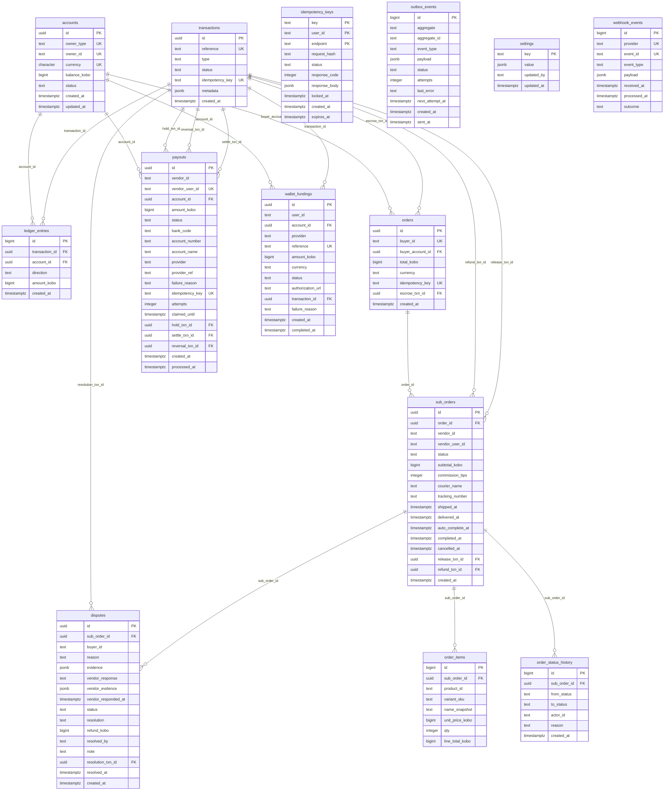

# KoboMarket

A multi-vendor marketplace backend. Buyers pay into escrow from a wallet; money is released to vendors when the buyer confirms delivery or 72 hours after shipping. Every naira movement is recorded in a double-entry ledger in PostgreSQL.

**Stack:** Node.js 22 · Express · MongoDB (catalogue, users) · PostgreSQL (money) · Redis + BullMQ (jobs)

## Quick start

```bash
cp .env.example .env
docker compose up -d
docker compose exec api npm run seed
```

`npm run seed` adds demo data and is safe to run again (nothing is created or credited twice):

| Role   | Email                                                                  | Notes                                                  |
| ------ | ---------------------------------------------------------------------- | ------------------------------------------------------ |
| Admin  | `admin@kobomarket.test`                                                |                                                        |
| Vendor | `ada@kobomarket.test`, `tunde@kobomarket.test`, `musa@kobomarket.test` | Approved stores with 20 products between them          |
| Buyer  | `chioma@`, `emeka@`, `fatima@`, `kunle@`, `ngozi@kobomarket.test`      | Wallets funded through the ledger (₦50,000–₦1,000,000) |

Every demo account's password is `KoboMarket#2026`. Demo data only: it refuses to run with `NODE_ENV=production`.

- API: http://localhost:3000
- Health: http://localhost:3000/health
- API docs (Swagger UI): http://localhost:3000/api-docs · raw OpenAPI JSON: http://localhost:3000/api-docs.json

### Running without Docker

Requires **Node.js 22** (newer major versions need a newer macOS).

```bash
cp .env.example .env   # then switch to Option B in the Databases section
npm install
npm run migrate
npm run seed           # demo data (optional)
npm run dev            # API
npm run dev:worker     # background jobs, in a second terminal
```

## Project structure

```text
src/
  app.js, server.js, worker.js   express app, HTTP entry, background worker entry
  config/                        env validation (fails fast on boot)
  db/                            postgres (knex), mongo (mongoose), redis
  shared/                        errors, middleware, money helpers, logger, events
  integrations/payments/         Paystack + mock provider behind one interface
  modules/<feature>/             routes → controller → service → repository
  jobs/                          outbox relay, auto-complete, payouts, reconciler
migrations/   seeds/ (demo data)   scripts/ (seed, audit, make-admin)   tests/   docs/
```

## Why two databases

I use two databases because KoboMarket keeps two very different kinds of data.

**MongoDB is the shop window.** It holds users, vendor stores, products (with their variants and stock), carts, reviews and notifications. This data changes shape often: one product has sizes and colours, another has none, and a store can gain new fields. MongoDB lets each document carry what it needs without a migration every time, and its text search and flexible filters suit the product catalogue.

**PostgreSQL is the bank vault.** It holds wallets, the double-entry ledger, orders and sub-orders, disputes, payouts and settings. Money needs strict rules, and PostgreSQL enforces them itself, even if my code has a bug:

- **Transactions:** a checkout either happens completely or not at all.
- **Row locks** (`SELECT ... FOR UPDATE`): two payments cannot spend the same naira.
- **Constraints and triggers:** amounts are whole kobo in `BIGINT`, every transaction must balance to zero, and ledger rows can never be edited or deleted.

**The rule between them: money lives only in PostgreSQL.** MongoDB never holds a balance. A product price in MongoDB is only the catalogue price; what the buyer actually paid is copied into PostgreSQL at checkout (`order_items.unit_price_kobo`). The two sides are linked by IDs: a PostgreSQL account stores the MongoDB user's `_id` as `owner_id`.

**The cost:** one checkout touches both databases, so they could get out of step if one save works and the other fails. I handle that this way:

1. Reserve the stock in MongoDB first, then take the money in PostgreSQL.
2. If the PostgreSQL step fails, put the stock back.
3. If putting it back also fails, save a `compensations` record that a background job retries.
4. Every follow-up event is written to an `outbox_events` table in the same PostgreSQL transaction, so no event is lost even if Redis is down.

## Architecture



- **The API never talks to Redis.** A business change and its follow-up event are written in one PostgreSQL transaction (`outbox_events`); the worker relays events to BullMQ and runs the scheduled jobs. If Redis is down, the API keeps working and events wait.
- **Layers:** routes (RBAC + validation) → controllers (HTTP only) → services (all business logic, own the transactions) → repositories (the only code touching SQL or Mongoose).
- **Only `src/modules/ledger` writes ledger rows or balances.** Every money movement is one `LedgerService.post()` that must net to zero.

### Order lifecycle

One checkout creates one order and one sub-order per vendor. Each sub-order moves through this state machine (`src/modules/orders/state-machine.js`); any other move is refused with `409 INVALID_TRANSITION`.



## Money and the ledger

All money is integer **kobo** in `BIGINT` columns (NGN 1 = 100 kobo); amounts in requests must be JSON integers, and ESLint bans `parseFloat`/`toFixed` in money modules. Commission is in basis points (500 = 5%), rounded down, with the vendor getting the remainder, and is snapshotted on each sub-order at checkout.

| Event                                                 | Ledger transaction | Debit (−)                  | Credit (+)                                                                     |
| ----------------------------------------------------- | ------------------ | -------------------------- | ------------------------------------------------------------------------------ |
| Wallet funded (verified webhook)                      | `FUNDING`          | `EXTERNAL_PAYSTACK`        | buyer wallet                                                                   |
| Checkout                                              | `ESCROW_HOLD`      | buyer wallet               | `PLATFORM_ESCROW`                                                              |
| Cancel before shipping                                | `REFUND`           | `PLATFORM_ESCROW`          | buyer wallet                                                                   |
| Delivery confirmed / auto-complete / dispute rejected | `ESCROW_RELEASE`   | `PLATFORM_ESCROW`          | vendor wallet (net) + `PLATFORM_REVENUE` (commission)                          |
| Dispute: full refund                                  | `REFUND`           | `PLATFORM_ESCROW`          | buyer wallet                                                                   |
| Dispute: partial refund                               | `REFUND`           | `PLATFORM_ESCROW`          | buyer (refund) + vendor (rest − commission) + revenue (commission on the rest) |
| Payout requested                                      | `PAYOUT_HOLD`      | vendor wallet              | `PLATFORM_PAYOUT_CLEARING`                                                     |
| Payout succeeded                                      | `PAYOUT_SETTLE`    | `PLATFORM_PAYOUT_CLEARING` | `EXTERNAL_PAYSTACK`                                                            |
| Payout failed                                         | `PAYOUT_REVERSAL`  | `PLATFORM_PAYOUT_CLEARING` | vendor wallet                                                                  |

**The database refuses bad data even if the code has a bug:** `CHECK (amount_kobo > 0)`, `CHECK (balance_kobo >= 0)` on user wallets, a deferred trigger that rejects any transaction whose entries do not net to zero, and triggers that refuse `UPDATE`, `DELETE` and `TRUNCATE` on `ledger_entries` and `transactions` (mistakes are fixed with reversing entries). Each transaction's `reference` is unique (`ORD-<id>`, `SUB-<id>-RELEASE`, `DSP-<id>`, `PAY-<id>-HOLD`, the Paystack reference for funding), which is what makes every money event happen at most once.

**`npm run audit:ledger`** prints PASS or FAIL for: the whole ledger nets to zero, every cached balance equals the sum of its entries, every transaction balances, and no account is negative except `EXTERNAL_PAYSTACK`. Because `EXTERNAL_PAYSTACK` is the other side of every funding and every payout, its balance is exactly −(total funded − total paid out), so "the ledger nets to zero" is the brief's rule: all user wallets + escrow + revenue + payout clearing = total funded − total paid out.

## Data model

### PostgreSQL (generated from the live schema by `npm run docs:generate`)

<!-- erd:start -->



<!-- erd:end -->

### MongoDB collections (generated from the Mongoose models by `npm run docs:generate`)

No collection holds money as a source of truth: a product's `priceKobo` is only the catalogue price (what a buyer paid is copied into `order_items`), and a user's `walletStatus` only says whether their PostgreSQL wallet has been opened.

<!-- collections:start -->

| Collection           | Fields                                                                                                             | Indexes                                                                                                                                                                                |
| -------------------- | ------------------------------------------------------------------------------------------------------------------ | -------------------------------------------------------------------------------------------------------------------------------------------------------------------------------------- |
| `carts`              | userId, items                                                                                                      | `{ userId }` (unique)                                                                                                                                                                  |
| `compensations`      | type, payload, reason, status, attempts, lastError, claimedUntil                                                   | `{ status, updatedAt }`                                                                                                                                                                |
| `loginAttempts`      | key, count, windowStart                                                                                            | `{ key }` (unique)<br>`{ windowStart }` (TTL)                                                                                                                                          |
| `notifications`      | userId, type, title, body, data, readAt, sourceEventId                                                             | `{ userId, sourceEventId, type }` (unique)<br>`{ userId, readAt, _id -1 }`<br>`{ userId, _id -1 }`                                                                                     |
| `products`           | vendorId, name, slug, description, category, priceKobo, stock, variants, tags, images, rating, isActive, deletedAt | `{ slug }` (unique)<br>`{ name text, description text, tags text }`<br>`{ category, priceKobo, _id }`<br>`{ vendorId, _id -1 }`<br>`{ priceKobo, _id }`<br>`{ rating.avg -1, _id -1 }` |
| `reviews`            | productId, buyerId, subOrderId, rating, comment                                                                    | `{ productId, buyerId }` (unique)<br>`{ productId, _id -1 }`                                                                                                                           |
| `sessions`           | userId, familyId, tokenHash, replacedBy, revokedAt, expiresAt, ip, userAgent                                       | `{ userId }`<br>`{ familyId }`<br>`{ tokenHash }` (unique)<br>`{ expiresAt }` (TTL)                                                                                                    |
| `users`              | email, passwordHash, name, roles, emailVerifiedAt, status, frozenAt, frozenBy, frozenReason, walletStatus          | `{ email }` (unique)<br>`{ walletStatus }`                                                                                                                                             |
| `vendors`            | userId, storeName, slug, description, bank, status, rejectionReason, reviewedBy, reviewedAt                        | `{ userId }` (unique)<br>`{ slug }` (unique)<br>`{ status, _id }`                                                                                                                      |
| `verificationTokens` | userId, type, tokenHash, expiresAt, usedAt                                                                         | `{ userId }`<br>`{ tokenHash }` (unique)<br>`{ expiresAt }` (TTL)                                                                                                                      |

<!-- collections:end -->

## Consistency, concurrency and idempotency

### Keeping MongoDB and PostgreSQL in step

They cannot share a transaction, so KoboMarket uses **compensating actions** where one request touches both, and the **transactional outbox** for everything that happens afterwards.

| Problem                                                              | What happens                                                                                                                                                                                                                                                         | Proved by                                                                                                                     |
| -------------------------------------------------------------------- | -------------------------------------------------------------------------------------------------------------------------------------------------------------------------------------------------------------------------------------------------------------------- | ----------------------------------------------------------------------------------------------------------------------------- |
| User created in MongoDB, wallet creation in PostgreSQL fails         | Registration still succeeds with `walletStatus: PENDING`; money endpoints answer `409 WALLET_NOT_READY`; the wallet reconciler job opens the wallet (idempotent) and sets `READY`                                                                                    | [`auth.register.test.js`](tests/integration/auth.register.test.js), [`maintenance.test.js`](tests/jobs/maintenance.test.js)   |
| Checkout touches stock (MongoDB) and money (PostgreSQL)              | Stock is **reserved first** (one conditional `$inc` per line, all or nothing), then one PostgreSQL transaction takes the money and creates the order. If that fails, the stock is put back; if putting it back fails, a `compensations` document is retried by a job | [`checkout.test.js`](tests/integration/checkout.test.js), [`stock.test.js`](tests/integration/stock.test.js)                  |
| Follow-up work (notifications) must not be lost or block the request | The event is an `outbox_events` row in the same transaction as the change; the worker relays it with `FOR UPDATE SKIP LOCKED`, a lease and backoff (DEAD after 10 tries). Delivery is at least once, so handlers are idempotent                                      | [`outbox-relay.test.js`](tests/jobs/outbox-relay.test.js), [`notifications.test.js`](tests/integration/notifications.test.js) |

I chose reserve-first over the brief's literal order (money first, then stock with a refund): a sold-out item then never touches a wallet, and undoing a stock reservation is simpler and safer than undoing a payment.

### Concurrency

| Race                                                 | Guard                                                                                                                                                                                                                                                                 | Proved by                                                                        |
| ---------------------------------------------------- | --------------------------------------------------------------------------------------------------------------------------------------------------------------------------------------------------------------------------------------------------------------------- | -------------------------------------------------------------------------------- |
| 10 checkouts at once, wallet affords 3               | `SELECT ... FOR UPDATE` on the wallet inside `LedgerService.post()`, accounts locked in ascending id order; the escrow hold is posted **first** in the checkout transaction (taking the lock before any foreign-key share lock, which deadlocked in an early version) | [`checkout.concurrency.test.js`](tests/concurrency/checkout.concurrency.test.js) |
| 2 buyers, last item                                  | Conditional `$inc` (`stock >= qty`) in MongoDB                                                                                                                                                                                                                        | [`checkout.test.js`](tests/integration/checkout.test.js)                         |
| 2 payout requests in the same millisecond            | Wallet row lock + partial unique index: one `PENDING` payout per vendor                                                                                                                                                                                               | [`payouts.concurrency.test.js`](tests/concurrency/payouts.concurrency.test.js)   |
| Opposite-direction transfers                         | Locks always taken in ascending account id, so no deadlock                                                                                                                                                                                                            | [`ledger.concurrency.test.js`](tests/concurrency/ledger.concurrency.test.js)     |
| Buyer confirms while auto-complete runs; two workers | `FOR UPDATE SKIP LOCKED` and a re-check of the status after the lock                                                                                                                                                                                                  | [`auto-complete.test.js`](tests/jobs/auto-complete.test.js)                      |
| Duplicate webhook, sent twice or five times at once  | Unique `webhook_events` id, funding row lock, unique ledger reference                                                                                                                                                                                                 | [`wallet.webhook.test.js`](tests/integration/wallet.webhook.test.js)             |
| Parallel reviews                                     | One atomic pipeline update of the rating                                                                                                                                                                                                                              | [`reviews.test.js`](tests/integration/reviews.test.js)                           |

### Idempotency

`POST /wallet/fund`, `POST /orders/checkout` and `POST /payouts` require an `Idempotency-Key` header. One `INSERT ... ON CONFLICT` claims the key per user and endpoint; the same key and body replay the stored response, a different body is `409 IDEMPOTENCY_KEY_REUSED`, a request still running is `409 REQUEST_IN_PROGRESS`, and a server error frees the key for a retry. Keys expire after 24 hours. Proved by [`idempotency.test.js`](tests/integration/idempotency.test.js) and the endpoint tests.

## Tests

```bash
npm test               # everything (integration tests need the databases in .env / .env.local)
npm run test:unit      # no database needed
npm run audit:ledger   # PASS / FAIL money check; CI runs it after the whole suite
```

CI (GitHub Actions) runs lint and unit tests, then starts the whole stack with `docker compose up`, runs every integration, concurrency and job test inside it, proves the worker relays an event through Redis, runs `npm run seed` twice, and finishes with `npm run audit:ledger`.

| Required test (brief §8)                                  | File                                                                                                                            |
| --------------------------------------------------------- | ------------------------------------------------------------------------------------------------------------------------------- |
| 1. Login fails before email verification                  | [`auth.login.test.js`](tests/integration/auth.login.test.js)                                                                    |
| 2. Reused refresh token is rejected and ends all sessions | [`auth.sessions.test.js`](tests/integration/auth.sessions.test.js)                                                              |
| 3. A buyer cannot reach vendor or admin routes            | [`rbac.test.js`](tests/integration/rbac.test.js)                                                                                |
| 4. The same webhook twice credits once                    | [`wallet.webhook.test.js`](tests/integration/wallet.webhook.test.js)                                                            |
| 5. A badly signed webhook is rejected                     | [`wallet.webhook.test.js`](tests/integration/wallet.webhook.test.js)                                                            |
| 6. Insufficient balance: no order, no ledger entries      | [`checkout.test.js`](tests/integration/checkout.test.js)                                                                        |
| 7. 10 concurrent checkouts, wallet affords 3 → exactly 3  | [`checkout.concurrency.test.js`](tests/concurrency/checkout.concurrency.test.js)                                                |
| 8. 2 buyers, last item → exactly 1                        | [`checkout.test.js`](tests/integration/checkout.test.js)                                                                        |
| 9. Same Idempotency-Key on checkout → one order           | [`checkout.test.js`](tests/integration/checkout.test.js)                                                                        |
| 10. Invalid transition (PAID → COMPLETED) rejected        | [`state-machine.test.js`](tests/unit/state-machine.test.js), [`orders.fulfil.test.js`](tests/integration/orders.fulfil.test.js) |
| 11. Completion splits vendor and revenue correctly        | [`orders.fulfil.test.js`](tests/integration/orders.fulfil.test.js)                                                              |
| 12. Auto-complete skips a disputed sub-order              | [`auto-complete.test.js`](tests/jobs/auto-complete.test.js), [`disputes.test.js`](tests/integration/disputes.test.js)           |
| 13. Partial refund leaves the ledger balanced             | [`disputes.test.js`](tests/integration/disputes.test.js)                                                                        |
| 14. Failed payout returns the money                       | [`payout-processor.test.js`](tests/jobs/payout-processor.test.js)                                                               |
| 15. `audit:ledger` passes after the suite                 | CI `docker-smoke` job                                                                                                           |

The ledger is append-only, so tests never wipe tables: each test creates its own users, wallets and products and asserts only on those.

## Assumptions and design decisions

Points the brief leaves open, and what KoboMarket does about them.

- **Vendors cannot buy their own products.** The brief allows one account to be both buyer and vendor but says nothing about self-purchase. Blocking it (at add-to-cart and again at checkout) stops a vendor faking sales to climb the "top vendors" report.
- **Frozen users can still fund their wallet.** The brief blocks orders and withdrawals for frozen accounts; money coming in is harmless.
- **A rejected vendor may apply again**, which puts the same application back to PENDING. Only approved stores are visible publicly.
- **Product stock is set absolutely by the vendor** (`PATCH /products/:id`). If a checkout decrements stock between the vendor reading and saving, the vendor's number wins. A delta endpoint using `$inc` would close this; listed under known limitations.
- **No relevance ordering for product search.** Search narrows results and the chosen sort orders them, because a text-relevance score cannot be used as a pagination cursor.
- **Checkout reserves stock first, then takes money.** The brief's order is money first, then stock with a refund if stock fails. Reserving first (one conditional `$inc` per line, all or nothing) means a sold-out item never touches the wallet, and if the Postgres transaction fails the stock is simply put back; a put-back that itself fails is saved as a `compensations` document for the reconciler.
- **Inside the checkout transaction the escrow hold is posted before the order rows.** That takes the wallet row lock first; inserting the order first took a foreign-key share lock on the wallet and parallel checkouts deadlocked upgrading it (found by the 10-concurrent-checkouts test).
- **A changed price stops checkout.** The cart is updated to the live price and the buyer checks out again, so nobody pays a price they have not seen.
- **Cancelling is all or nothing.** An order can be cancelled only while every sub-order is still PAID; if any vendor has shipped, the cancel is refused.
- **The commission rate is snapshotted per sub-order at checkout**, so an admin changing the rate later does not change what was agreed.
- **Order status is derived** from the sub-orders (their shared status, or `IN_PROGRESS`), never stored, so the two cannot disagree.
- **Shipping requires a courier name and tracking number.**
- **Vendors list their own sub-orders** at `GET /vendors/me/sub-orders` (not in the brief's endpoint list, but vendors must be able to "view orders").
- **The API never talks to Redis.** Every business change writes an `outbox_events` row in the same Postgres transaction; the worker relays those rows to a BullMQ queue. If Redis is down, checkouts still work and events wait in the outbox. Relaying claims rows with `FOR UPDATE SKIP LOCKED` and a short lease, publishes after the transaction (no network call while holding row locks), and backs off then marks a row `DEAD` after 10 failures. Delivery is at least once, so event handlers are idempotent.
- **Scheduled jobs are safe to run on several workers at once.** Auto-complete re-locks each sub-order with `status = 'SHIPPED'` and `SKIP LOCKED` (so a disputed or just-confirmed sub-order is skipped, and escrow is released once); compensation retries are claimed with a lease.
- **Disputes are opened before confirming delivery.** Confirming means "I am satisfied": it moves the sub-order through DELIVERED to COMPLETED and releases the money in one step, so the brief's DELIVERED → DISPUTED move exists in the state machine but is not reached. A buyer with a problem disputes while the sub-order is SHIPPED, which also stops auto-complete.
- **`REFUNDED` is an extra sub-order state** for a fully refunded dispute, so it does not look like a completed sale. A partial refund or a rejected dispute ends `COMPLETED`.
- **A partial refund is one balanced posting**: escrow → buyer (refund), vendor (the rest minus commission) and revenue (commission on the rest only).
- **Vendors can reply to a dispute once with their own evidence**, and admins see both sides. `GET /disputes/mine` lists a user's disputes as buyer or vendor.
- **Refunds do not restock.** The goods have shipped; returns handling is out of scope.
- **Payouts: hold first, transfer later.** A request moves the money from the vendor wallet to `PLATFORM_PAYOUT_CLEARING` at once (posted before the payout row, so the wallet is locked first); a worker sends the transfer outside any database transaction and then settles (clearing → `EXTERNAL_PAYSTACK`) or reverses (clearing → vendor). Two requests in the same millisecond queue on the wallet lock; the second fails on funds or on the one-PENDING-payout index and rolls back. The payout id is the transfer reference, so a retried transfer cannot pay twice.
- **A provider error never reverses a payout.** We cannot know whether the money left, so the payout stays PENDING and is retried (an error is logged after 10 attempts for an admin). Only a definite "failed" from the provider returns the money. While a payout is PENDING the vendor cannot request another (the brief's rule).
- **Bank details are copied onto each payout** when it is requested, so a later change of bank account cannot redirect a payout in flight.
- **Reviews need a completed order**, checked in PostgreSQL (where orders live): a sub-order in `COMPLETED` containing the product. One review per buyer per product (unique index). The product's rating is one atomic MongoDB pipeline update that adds to `rating.sum` and `rating.count` and recomputes `rating.avg` from them, so parallel reviews never lose a vote.
- **Freezing a user acts in both databases.** The user is marked `FROZEN` in MongoDB (checkout and payouts refuse them) and their wallet is marked `FROZEN` in PostgreSQL, so `LedgerService.post()` itself refuses any debit from it, even from a code path that forgot to check. Refunds can still be credited. Freeze and unfreeze are safe to repeat; an admin cannot freeze themselves.
- **Reports are computed in SQL**, never in JavaScript loops, and count days and months in Lagos time (`Africa/Lagos`). Revenue per day lists every day in the range, with zero for days without sales. Top vendors count sub-orders completed this month, net of partial refunds. The escrow report shows the `PLATFORM_ESCROW` balance beside the unfinished sub-orders that should account for it.
- **`GET /admin/transactions`** lists every ledger transaction with its entries; it is not in the brief's endpoint list but delivers "view all transactions" from the admin role.
- **A commission change applies to new checkouts only** and is capped at 50% to stop a typo handing the platform the whole sale.

## Known limitations and improvements

- **Every escrow movement locks the one `PLATFORM_ESCROW` row**, so checkouts, releases and refunds across the whole platform queue behind each other. Correct, and fine at this scale; a busy marketplace would split escrow into several accounts (or per-vendor escrow) to spread the lock.
- **Tests share one database.** Integration tests run against the Neon `production` branch locally (CI uses a fresh Postgres in Docker). Tests never wipe tables (the ledger forbids it) and assert only on their own data, but a separate Neon `test` branch would be cleaner.
- **The app connects as the table owner**, so the append-only triggers are the real guard on ledger rows. A restricted role with `UPDATE`/`DELETE` revoked on ledger tables would add a second wall.
- **Vendors set stock as an absolute number** (`PATCH /products/:id`). A checkout reserving stock between the vendor reading and saving would be overwritten; a `$inc`-based stock adjustment endpoint would close that.
- **Search has no relevance ordering**, because a text score cannot be a pagination cursor.
- **Dead jobs are only visible in logs and the database.** Outbox events marked `DEAD`, `DEAD` compensations, and payouts stuck `PENDING` because the provider is unreachable are logged as errors, but there is no admin screen to retry them.
- **Two writes that are not one transaction:** a review and the product's rating update, and a compensation that ran but was not yet marked done. Both are rare crash windows; `rating.sum`/`rating.count` allow an exact recompute from the reviews.
- **The mock payment provider keeps its state in memory**, so a funding started before an API restart cannot be paid on the mock checkout afterwards (start a new one). Real Paystack has no such limit.
- **Reports use Lagos time** (`Africa/Lagos`) and NGN only; there is no multi-currency support.
- **Notifications are polled** (`GET /notifications`); real-time delivery with Socket.io is a listed bonus not built.
- **Future improvements** (out of scope for this project): a delivery confirmation code the buyer reads to the rider, returns and restocking after refunds, KYC checks on vendor bank details, partial shipments, and real email delivery (emails are logged to the console).
